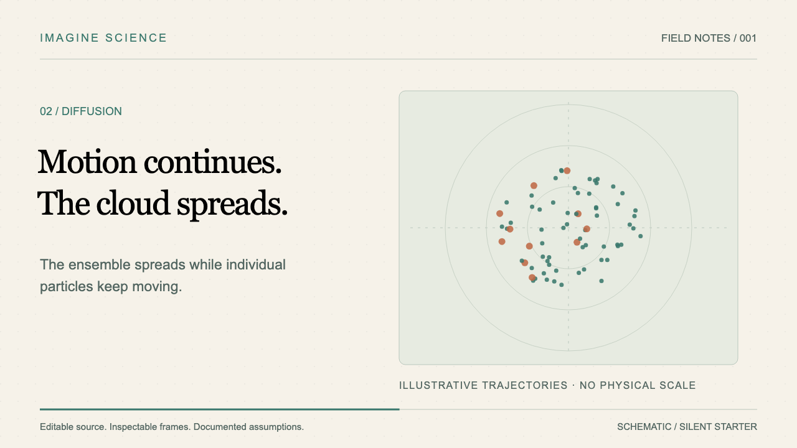

# Imagine Science

**Scientific explanations you can edit, inspect, and trace back to their sources.**

[](LICENSE)

Imagine Science combines an installable Codex skill, a runnable Remotion starter,
and tools for rendered-frame review and export verification. Supply a scientific
brief, references, and assets; work with your agent to produce an editable film.



*Included example: a silent, 12-second schematic of a spreading particle cloud.
The trajectories illustrate a concept; they are not a calibrated simulation or
experimental data.*

## What is included

- **Scientific production skill:** source review, explicit assumptions, scene
  planning, provenance, narration timing, and a bounded visual correction loop.
- **Remotion starter:** editable React/SVG animation, a frame-based scene manifest,
  optional prepared narration, and phrase captions.
- **Review tools:** exact-frame PNGs, an evidence index, an unreviewed report, and
  a contact-sheet command for exported videos.
- **Technical verification:** decoded frame count, dimensions, timing, codec,
  audio policy, full decoding, and optional audio-energy/stationary-region checks.

The editor and renderer are Remotion. Image/video generation and speech synthesis
use separately available tools or supplied files. No provider clients, API keys,
model weights, or hosted services are included. The default example runs locally
without paid generation.

## Quick start

Install **Node.js 22.13 or newer**, Git, **FFmpeg**, and **ffprobe**. On macOS,
Homebrew supplies both media tools with `brew install ffmpeg`; on Ubuntu use
`sudo apt-get install ffmpeg`.

```sh
git clone https://github.com/iamnikhiliyer/imagine-science.git
cd imagine-science
npm ci
npm run doctor
npm run dev
```

Open the local URL printed by Remotion, then choose **Diffusion**. The development
server runs until you stop it. First rendering may download Remotion's Chrome
Headless Shell; preview and rendering require a browser-capable environment.

```sh
npm run check           # Manifest/assets, lint, types, and tests
npm run review          # Render boundary/cue/extra-frame evidence
npm run render          # Export out/film.mp4
npm run verify          # Check the exported media; write verification JSON
npm run contact-sheet   # Sample a visual overview of the MP4
```

Outputs stay in `out/` and are ignored by Git. Review evidence starts as
**unreviewed**. Inspect the images, watch continuous motion, listen to any audio,
and record your findings; generating a report does not perform that review.

## Install the Codex skill

In Codex, ask its built-in installer:

```text
$skill-installer Install the imagine-science skill from
https://github.com/iamnikhiliyer/imagine-science/tree/main/skills/imagine-science
```

Or copy the entire `skills/imagine-science` directory from this checkout into
your user skill directory, such as `~/.agents/skills/imagine-science`. Preserve
the scripts and references alongside `SKILL.md`; copying that file alone is not
enough. Start a new session if your client has not discovered the installed skill.

Then request, for example:

```text
Use $imagine-science to make a 45-second scientific explainer from the references
and assets in this project. Start with a source/claim map, an editable scene plan,
and a Studio preview. Record what is schematic and what is measured. Prepare
exact-frame review evidence before exporting.
```

Installing the skill supplies workflow instructions and helper scripts. The film
project still needs its own Node dependencies and the media tools above. The
skill can use the starter or an existing Remotion project.

## Make your own film

1. Write the learning objective, audience, supported claims, and visual references.
2. Put redistributable media under `public/`, then register its source, rights,
   classification, and optional hash in `film.project.json`.
3. Replace the example in `src/Diffusion.tsx` or register your own composition.
   Keep the composition metadata and manifest in agreement.
4. Update scene ranges, review cues, and motion-extrema frames. Ranges are
   half-open: `[startFrame, endFrame)`.
5. For narration, supply a prepared audio file, add it to the asset manifest, set
   `audio.mode` to `narrated`, and enter captions aligned to the actual speech.
6. Review evidence, make corrections, export, and verify. Record scientific
   review separately from visual scores.

Read [the manifest reference](skills/imagine-science/references/project-format.md)
for the exact format, optional speech windows, stationary regions, and use in an
existing project. Read [scientific production](skills/imagine-science/references/scientific-production.md)
for source and claims conventions, and [visual review](skills/imagine-science/references/visual-review.md)
for coverage and verification limits.

## Project layout

```text
film.project.json             Scene plan, metadata, provenance, review settings
src/                         Editable Remotion example and audio/caption component
public/                      Your registered film assets
skills/imagine-science/       Installable skill, references, and portable scripts
tests/                       Contract, media, and installed-skill tests
docs/                        Starter preview and development evidence
out/                         Local generated artifacts (ignored)
```

Tools can also run from an installed skill outside the repository:

```sh
# Run from the root of the film project; substitute the actual skill path.
node /path/to/imagine-science/scripts/cli.mjs review 90 120 121
```

Use `npm run render -- out/custom.mp4` for another output path. Optional
`IMAGINE_CHROME` selects a Chrome executable; `IMAGINE_CONCURRENCY` sets render
workers (default 2). Helpers use the Node APIs, so CLI-only settings in
`remotion.config.ts` do not automatically change helper behavior.

## Status and limits

This is an early toolkit extracted from a personal scientific film workflow.
The public starter establishes installation, preview, rendering, and review
mechanics. Its first independent scientific film extraction test is still ahead.

Validation checks the declared timeline and registered assets; it does not
discover every file referenced in source code. Audio-energy checks cannot prove
speech content. Stationary-region checks require deliberately chosen regions
and thresholds. Sampled stills cannot establish every-frame visual quality or
scientific correctness. Researcher review remains part of production.

## Development and contributing

Use `npm ci`, `npm run check`, and `npm run build`. Media integration tests use
the local FFmpeg installation. A [GitHub Actions template](ci/README.md) runs those
checks and renders/verifies the starter. It is supplied as a template because the
initial publishing credential could not upload active workflows. See
[CONTRIBUTING.md](CONTRIBUTING.md) for focused contributions and
[docs/verification.md](docs/verification.md) for the initial validation record.

Dependencies are pinned in `package-lock.json`; installation lifecycle scripts
are disabled in `.npmrc`. The compatible `typescript-eslint` override keeps the
lint dependency tree on its patched release. Upgrade related Remotion packages
together, review lockfile changes, and run the checks before committing.

## License and acknowledgments

Original code, skill instructions, and original starter artwork are
[MIT licensed](LICENSE). Dependencies and external tools retain their own
licenses. In particular, Remotion uses its own license and may require a company
license depending on your use; consult [Remotion's terms](https://www.remotion.dev/license).
FFmpeg's licensing depends on the installed build. Review rights for any media
you add. See [NOTICE.md](NOTICE.md).

Created by [Nikhil Iyer](https://github.com/iamnikhiliyer).
