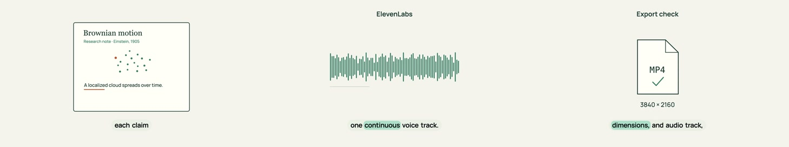

# Imagine Science

Imagine Science is an open-source toolkit for making scientific animations with a coding agent. A researcher supplies the paper, figures, or project references and decides what the explanation should say. The agent writes editable React and SVG scenes in TypeScript. Remotion renders the frames, and FFmpeg produces the video for playback.

[Watch the 92-second film](https://nikhil-site.pages.dev/projects/imagine-science/) · [Explore its editable project](examples/imagine-science/) · [Install the Codex skill](#install-the-codex-skill)

[](examples/imagine-science/)

## Open the studio

Install Git, Node.js 22.13 or newer, and FFmpeg with ffprobe. On macOS, `brew install ffmpeg` supplies both media tools. The first render can download Remotion’s Chrome Headless Shell.

```sh
git clone https://github.com/iamnikhiliyer/imagine-science.git
cd imagine-science
npm ci
npm run doctor
npm run dev:explainer
```

Open the local URL printed by Studio and select **Imagine-Science**. The checkout includes the final voice track, so you can preview, edit, and render the film offline once dependencies and the browser are installed. To start a smaller project, `npm run dev` opens **Diffusion**, a silent 12-second schematic with the same manifest and review tools.

## How a film comes together

| Stage | What you can inspect or change |
| --- | --- |
| Establish the explanation | Record the audience, sources, supported claims, and which visuals are illustrative. Write one continuous script and choose the action that makes each step visible. [Production brief](examples/imagine-science/production/brief.md) |
| Build the scene | React lays out the figure, SVG draws its parts, and Remotion’s frame number drives each change. The example follows a particle cloud through writing, narration, rendering, and a timing correction. [Scene code](examples/imagine-science/src/Film.tsx) |
| Match the voice to the action | The finished film uses ElevenLabs Bella. The recording’s word timestamps cue the motion and the mint highlight on the spoken word. Longer phrases supply the selectable subtitle track. You can also bring an aligned Kokoro or recorded narration. [Narration workflow](skills/imagine-science/references/narrated-films.md) |
| Review and deliver | Inspect exact frames around a cue, play through the transitions, correct the source, and render again. The verifier checks the decoded H.264 picture, timing, dimensions, and expected audio. The optional web export enforces a byte limit. [Review guide](skills/imagine-science/references/visual-review.md) |

## Render the included projects

Run these commands from the repository root. Each project writes to its own ignored `out/` directory.

| Operation | Narrated 4K explainer | Silent starter |
| --- | --- | --- |
| Check manifest and assets | `npm run explainer -- validate` | `npm run validate` |
| Inspect selected frames | `npm run explainer -- review 720 1350` | `npm run review -- 90 120` |
| Render MP4 | `npm run explainer -- render` | `npm run render` |
| Decode and verify MP4 | `npm run explainer -- verify` | `npm run verify` |
| Write a contact sheet | `npm run explainer -- contact-sheet` | `npm run contact-sheet` |

`npm run explainer -- subtitles` writes the phrase captions to `examples/imagine-science/out/en.vtt`. After rendering, `npm run explainer -- web 8000000` makes a fast-start MP4 of at most 8,000,000 bytes and verifies the result. It keeps the audio stream and uses two-pass video compression when needed. Inspect fine labels and motion at playback size after choosing a compression budget.

## Install the Codex skill

Ask Codex’s skill installer to install the directory from GitHub.

```text
$skill-installer Install https://github.com/iamnikhiliyer/imagine-science/tree/main/skills/imagine-science
```

You can also copy the complete `skills/imagine-science` folder to `~/.agents/skills/`. Start a new session if the client needs to rediscover skills. The film project supplies its own Node dependencies.

> Use $imagine-science to explain this figure to researchers outside the field. Trace the main claim to the paper, draft a continuous narration, and animate the figure so the critical step lands on the spoken cue. Give me the editable project, a captioned MP4, and the exact frames you checked.

For an existing Remotion project, add a project manifest and run the installed skill’s helpers from that project’s root. Set `IMAGINE_CHROME` to use a specific browser or `IMAGINE_CONCURRENCY` to choose the render worker count. [Manifest reference](skills/imagine-science/references/project-format.md)

## Development and rights

Run `npm run check` for both manifests, linting, types, and tests. Run `npm run build` to bundle the starter. Generating stills and passing technical verification are parts of review. Researchers assess the scientific claims and what each visual implies. [Contributing](CONTRIBUTING.md) · [CI template](ci/README.md)

Original code, instructions, and original schematic artwork are MIT licensed. Remotion, fonts, FFmpeg, and the generated voice recording have their own terms. [License](LICENSE) · [Notices](NOTICE.md)
